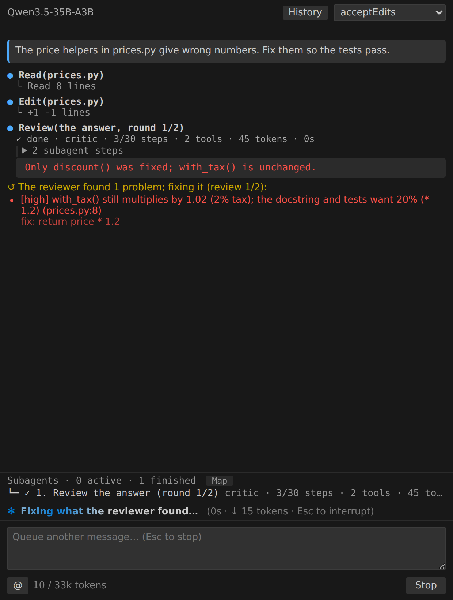

# The critic: a second check before you see the answer

With the critic on, a read-only **critic agent** checks each answer before
it's shown: against your request, the files, and the changes made in the
turn.

- **It passes:** you see the answer, marked "✓ Reviewed".
- **It finds a problem:** you see what it found ("The reviewer found 1
  problem; fixing it"), cmcoder fixes it, and the critic looks again, up to
  `critic.maxRounds` times (default 2, at most 5). If it still isn't right,
  the answer is shown marked "not validated".



## Turning it on

| Where | How |
|---|---|
| VS Code and the other IDE chats | the **Critique** checkbox at the top of the chat |
| Terminal, TUI | `/critic on` (`/critic off`), or start with `cmcoder --critic` |
| Settings | `"critic": {"enabled": true, "maxRounds": 2}` |

The checkbox is saved in your settings (`~/.cmcoder/settings.json`), and every
running cmcoder follows it: other IDE windows within seconds, the terminal and
TUI from their next message. `/critic` and `--critic` are for one session.

It costs time and tokens: each check is another model call (the main model)
with the turn's changes. Turn it on for work you want checked, such as
changes you'll commit without reading every line.

## Your team's standards

A `critic.md` in your agents folder (`~/.cmcoder/agents/critic.md`, or a
trusted project's `.cmcoder/agents/critic.md`) replaces its instructions: for
example your team's review checklist. Same format as any agent
([agents.md](agents.md)).

```markdown
---
name: critic
description: Checks the final answer before it is shown.
---
Check the answer and the changes against the request. Also fail it when:
- a new public method has no test;
- an error is caught and ignored;
- a URL, password or key is written in the code.
Report each problem with file:line.
```

## Critic, reviewer agent, or hook?

| | Runs | Good for |
|---|---|---|
| The critic | automatically, on every answer | catching a wrong or incomplete answer before you rely on it |
| A `reviewer` subagent | when the agent (or your process) calls it | a review step in a team's process ([team.md](team.md)) |
| A `Stop` hook | on every answer, your own command | a hard check: tests must pass ([hooks.md](hooks.md)) |

More screenshots: the terminal
[reviewing](screenshots/critic-1-reviewing.png),
[fixing](screenshots/critic-2-fixing.png),
[passed](screenshots/critic-3-passed.png),
[not validated](screenshots/critic-4-not-validated.png); the
[TUI](screenshots/critic-tui.png); VS Code
[passed](screenshots/critic-vscode-passed.png),
[not validated](screenshots/critic-vscode-not-validated.png) and the
[checkbox](screenshots/critic-checkbox.png).
